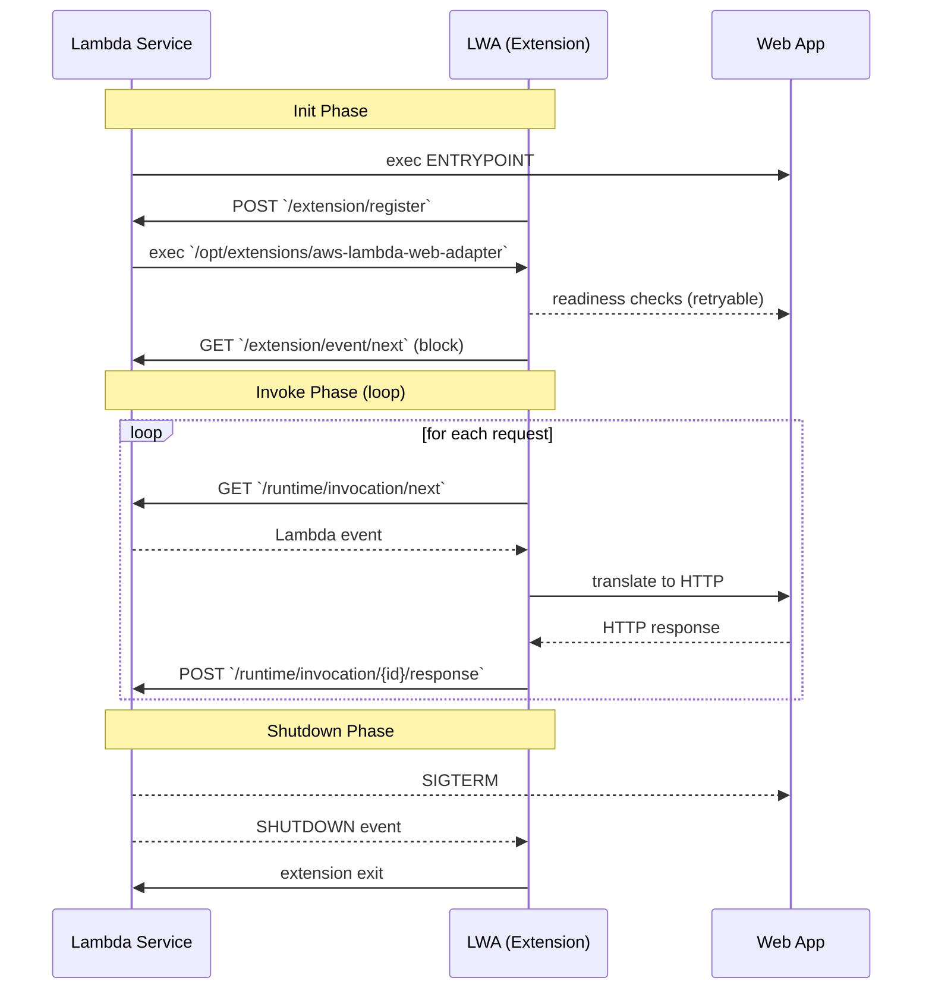

# はじめに
[Connect RPC](https://connectrpc.com/)は、gRPC互換かつHTTP/1.1でも動作するRPCプロトコルです。バクラク事業部では、Connect RPCをサービス間通信の標準プロトコルとして採用し、[connect-go](https://github.com/connectrpc/connect-go)や[connect-es](https://github.com/connectrpc/connect-es)を利用してサービスを実装しています。

https://tech.layerx.co.jp/entry/decoupling-a-service-from-monolith-with-Protocol-buffers-and-connect-go

Connect RPCを実装したサービスは、基本的にAWS Fargate (ECS) にデプロイしています。しかし、サービスのワークロードによっては、弾力性やコスト最適化の観点からAWS Lambda (以降Lambda) にデプロイしたいモチベーションがありました。Lambdaにデプロイする場合、通常はLambda Runtimeが期待するハンドラを用意する必要があります。もし、アプリケーションコードを変更することなく、Connect RPCサービスとしてそのままLambdaにデプロイできると便利です。

[AWS Lambda Web Adapter](https://github.com/awslabs/aws-lambda-web-adapter) (以降LWA) はこの課題を解決します。LWAはLambda extensionsとして動作し、LambdaのイベントをHTTP/1.1に変換してアプリケーションとやりとりしてくれます。Dockerイメージにしておくことで、ECSとLambdaの両方に同じイメージを使ってデプロイできます。この記事では、Lambda extensionsとLWAの説明をしつつ、サービス定義によるデプロイメント先の切り替えを紹介します。

# Lambdaに関する前提知識

ここでは、LWAの挙動を理解するために前提となる、Lambdaの知識を説明します。

## Lambda external extensions

Lambda extensionsにはInternal extensionsとExternal extensionsの2種類がありますが、LWAはExternal extensionsとして動作するため、以降ではExternal extensionsのみを扱います。

External extensionは `/opt/extensions` 以下に配置された実行ファイルとして認識されます。また、Extensionが余分に消費した実行時間は課金対象となります[^1]。
[^1]: 正確には、Init/ShutdownフェーズでExtensionが長く残った分が上乗せされます

https://docs.aws.amazon.com/lambda/latest/dg/lambda-extensions.html

## Lambdaの実行環境とライフサイクル

Lambdaの実行環境にはRuntimeプロセスとExtensionプロセスの2系統があります。

- Runtimeプロセス: Lambdaが起動する言語ランタイムとハンドラ (アプリケーションコード) を含む "本体" のプロセス
- Extensionプロセス: Runtimeとは独立して起動・終了する補助プロセス

また、基本的に3つのフェーズからなるライフサイクルを持ちます[^3]。ざっくりとした説明は次の通りです。
[^3]: Lambda SnapStartが有効な場合はRestoreフェーズが追加されます

1. Init: コールドスタート時。各プロセスを初期化
2. Invoke: 各リクエスト処理。ウォーム状態ではこのフェーズのみループ
3. Shutdown: 実行環境破棄前の後処理。スケールインや関数の更新などで発生

https://docs.aws.amazon.com/lambda/latest/dg/lambda-runtime-environment.html

## Lambda Runtime Interface

LambdaにデプロイしたRuntimeプロセスは、[Runtime API](https://docs.aws.amazon.com/lambda/latest/dg/runtimes-api.html)を通してLamdbaサービスとやりとりをすることでLambda関数として動作します。Runtime APIを実装したソフトウェアはRuntime Interface Client (以降RIC) と呼ばれます。[AWSのRuntime Dockerイメージ](https://gallery.ecr.aws/lambda/)では、ENTRYPOINT (`/lambda-entrypoint.sh`) がRICを起動する
ため、handlerを指定するだけでLambda関数として動作します。各言語のRICはOSSとして公開されています。例えばNode.js https://github.com/aws/aws-lambda-nodejs-runtime-interface-client です。独自のRICを実装して使用することも可能です。

# Lambda Web Adapterの挙動

LWAの実体は、Rustで実装されたバイナリです。これはExtensionでありながら、Runtime APIを実装したRIC (Custom Runtime) の役割を果たします。なお、LWAはZip/Layerの場合とDockerイメージの場合で挙動が異なります。本記事ではDockerイメージを前提にしているため、ここではDockerイメージの場合のみ説明します。ざっくりとした挙動を図で表したものが以下です。



Extensions APIではInvokeイベントを購読せず[^7]、代わりにRuntime APIでイベントを受け取ることがポイントです。これにより、アプリケーションコードを変更することなく、Extensionを配置するだけで、Lambda関数がHTTP/1.1を喋れるようになります。
[^7]: events配列を空にして登録しているためSHUTDOWN以外のイベントは届きません https://github.com/awslabs/aws-lambda-web-adapter/blob/92b4993f4b7668b8cd3aa93faf0d0e34e6f0c0e9/src/lib.rs#L229

https://docs.aws.amazon.com/lambda/latest/dg/runtimes-extensions-api.html

# サービス定義によるデプロイメント先の切り替え
ここでは、実際にLWAを使ってLambdaにデプロイする様子を紹介します。

各サービスは自前のJsonnetスキーマにより管理しつつ、その設定からアプリケーションとインフラのコードを自動生成をするようにしています。例えば、connect-goのサービスは次のイメージです。

```jsonnet
// カードサービス
{
	name: 'CardService', 
	owners: ['card']
	lang: 'go',
	features: {
		connect: true,
	},
	deployment: {
		destination: 'ecs',
	},
}
```

この定義を入力とし、アプリケーションとインフラのコードを自動生成しています。具体的には以下が含まれます。
- Go: connect-goをベースとしたサーバーのテンプレート
- Dockerfile
- GitHub Actions (YAML)
	- Dockerイメージをビルド・プッシュするワークフロー
	- ECSにデプロイするワークフロー
- Terraform
	- Dockerイメージのプッシュ先となるECRリポジトリ
  - ECSサービスに必要なIAMロールやセキュリティグループ、ターゲットグループ、リスナールールなど
- [ecspresso](https://github.com/kayac/ecspresso)の設定ファイル

次のように `deployment.destination` を変更すると、

```diff
@@ -6,6 +6,6 @@
                connect: true,
        },
        deployment: {
-               destination: 'ecs',
+               destination: 'lambda',
        },
 }
```

アプリケーションコード以外の生成物は次のように変化します。

- Dockerfile: aws-lambda-web-adapterを `/opt/extensions/` に配置
- GitHub Actions (YAML): Lambdaにデプロイするワークフロー
- Terraform: Lambda関数に必要なIAMロールやセキュリティグループ、ターゲットグループ、リスナールールなど
- [lambroll](https://github.com/fujiwara/lambroll)の設定ファイル

このように、サービス定義の変更だけでConnect RPCサービスをLambdaにデプロイし、**かつECSサービスと同じインターフェースを維持できます**。

:::message
なお、LambdaはECSと異なり[Multi-Architecture Imageをサポートしていない](https://repost.aws/questions/QUIZjd2sL_TtCuoqtg5Q30LA/does-lambda-not-support-multi-architecture-container-images-manifests)ため、アーキテクチャでタグを分離するなどの工夫が必要になります。
:::

# まとめ

Lambda Web Adapterを使うことで、既存のHTTPサーバをコード変更なしでLambdaに載せ替えられます。特にConnect RPCをサービス間通信の基盤プロトコルとしている場合、HTTP/1.1互換であることのメリットが強く活きます。サービス定義と自動生成コードで紹介したように、デプロイ先を柔軟に選択できるプラットフォームの構築にも役立っています。
